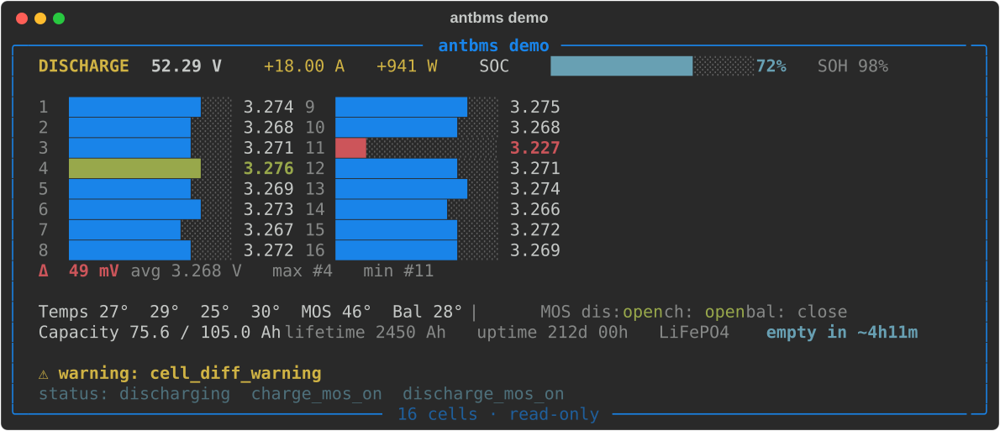
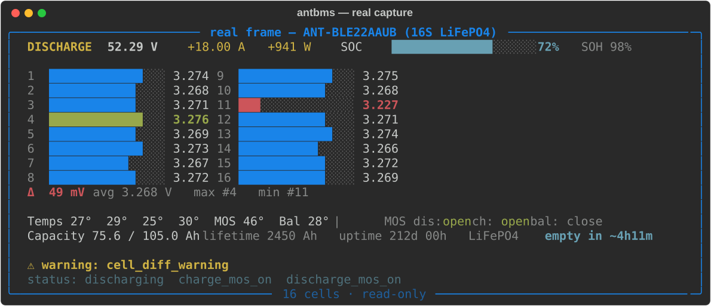

# ant-bms-ble

> Read-only BLE client, live TUI dashboard and **complete protocol
> specification** for ANT BMS (the "new" `7E A1` protocol), reverse-engineered
> from the official app and verified on real hardware.
>
> Documentación en español: [PROTOCOL.es.md](PROTOCOL.es.md)

[](https://github.com/yosle/ant-bms-ble/actions/workflows/ci.yml)
[](https://pypi.org/project/ant-bms-ble/)




That is the dashboard `antbms live` shows for **your** pack (the screenshot
itself is rendered by the built-in demo). No battery at hand? Get the same
dashboard with synthetic data — **no hardware and no Bluetooth needed**:

```bash
pip install ant-bms-ble
antbms demo
```

## What is this?

ANT BMS units (device names starting with `ANT-BLE`) speak an undocumented BLE
protocol. This repository contains:

- **[PROTOCOL.md](PROTOCOL.md)** — a standalone specification of the new
  `7E A1` protocol: framing and CRC, frame reassembly (including the
  undocumented *extra section* that the official parser silently skips), the
  full real-time layout, **~90 named protection/warning bits**, the complete
  parameter map (~200 registers with addresses, scaling and units), the
  read-unlock handshake, and the legacy `AA 55` protocol as an appendix.
  Available in English and [Spanish](PROTOCOL.es.md).
- **`antbms`** — a Python CLI with a live TUI dashboard, a one-shot
  config/state backup, a data logger and an offline frame decoder.
- **`antbms.protocol`** — the reference decoder: pure Python, zero
  dependencies, trivial to port to C++/JS/MicroPython.

Everything was extracted by static analysis of the official Android app and
verified against real hardware (ANT-BLE22AAUB-YCE7, firmware
22AAUB00-240510A). Captured frames are part of the test suite.

## Why another ANT BMS project?

Excellent integrations already exist — use them if they fit:
[esphome-ant-bms](https://github.com/syssi/esphome-ant-bms) (ESPHome/ESP32),
[batmon-ha](https://github.com/fl4p/batmon-ha) and
[BMS_BLE-HA](https://github.com/patman15/BMS_BLE-HA) /
[aiobmsble](https://github.com/patman15/aiobmsble) (Home Assistant).

What this repo adds is the layer under all of them, plus the tooling they
don't cover:

|  | existing integrations | **ant-bms-ble** |
|---|---|---|
| Standalone protocol spec | embedded in code | **full document, EN + ES** |
| Protection/alarm bits | raw bitmask or generic code | **all ~90 bits, by name** |
| Settings registers | partial | **~200 registers, named + scaled** |
| "Case C" extra section | — | **decoded & specified** |
| Config backup / audit | — | **`antbms report` → Markdown/JSON** |
| Works without HA/ESPHome | — | **pip install, done** |
| Write/control commands | yes | **never — read-only by design** |

## Quick start

```bash
pip install ant-bms-ble

antbms scan                           # find your battery
antbms live                           # the dashboard, your battery
antbms live --plain                   # classic text output
antbms live --json | jq .soc          # JSONL for scripting
antbms info                           # firmware versions, pack id, chip id
antbms params --block voltage --auth  # one settings block, decoded
antbms report --md --out my-pack.md   # FULL config + state backup
antbms log --csv pack.csv --interval 5
antbms demo                           # no battery? same dashboard, synthetic data
```

No hardware around? Decode a frame offline:

```bash
antbms decode 7ea11100009e01040410000000000000000010008801000000000000000000000000ca0cc40cc70ccc0cc50cc90cc30cc80ccb0cc40c9b0cc70cca0cc20cc80cc50c1b001d0019001e002e001c006d14b4004800620001010000402c42068090810450622500ad0300005a7e170100000000cc0c04009b0c0b003100c40c3400340000000000f2fa18100000541000001055220060361e0000000000000000000000fb00d3e6aa55
```

That hex is not sample data — it is an actual frame captured mid-discharge
from the pack in the [supported hardware](#supported-hardware) table. The same
frame rendered by the TUI:



### `antbms report` — back up and audit your configuration

Reads the device identity, **every** settings block (voltage, temperature,
current, balance, battery, system, customize, manufacturer, …) and a real-time
snapshot, and renders it as terminal tables, Markdown or JSON. Keep it in a
drawer before a firmware update, diff it between two packs, or attach it to a
warranty claim. Settings still showing `not configured` (`0xFFFF`)? Pass
`--auth` to send the level-1 read unlock first (see below).

## Safety: read-only by design

- The client can only ever send the four read commands (`0x01` real-time,
  `0x02` settings, `0x04` chip id, `0x05` info) — `build_read_request()`
  refuses anything else.
- The optional `--auth` handshake (`cmd 0x23`, default password `12345678`)
  only unlocks *reading* the settings blocks. It changes nothing.
- Write/control commands are **documented** in [PROTOCOL.md](PROTOCOL.md) for
  completeness, but this code never sends them.

## Things the official app gets wrong

Reverse engineering found real bugs worth knowing about (details in the spec):

- `packPower` is a **signed** 32-bit value; the app reads it unsigned and
  shows absurd numbers while charging. This client decodes the sign.
- On the legacy protocol the app reads `cellCount` *after* using it, so the
  first frame is interpreted with the previous count.
- The BMS appends a metadata *extra section* to some responses; the app's
  parser skips it blindly. It is actually a position/clamping marker — fully
  decoded here, and required to read long settings blocks correctly.

## Library use

```python
from antbms import protocol

frames, rest = protocol.find_frames(ble_bytes)
for frame in frames:
    if frame[2] == 0x11:
        snap = protocol.decode_realtime(frame)
        print(snap["soc"], snap["cellVoltages"], snap["protections"])
```

`antbms.protocol` has zero dependencies (`bleak` and `rich` are only imported
by the CLI), so it also runs on MicroPython-class targets with minor shims.

## Supported hardware

The new `7E A1` protocol is spoken by ANT BMS units whose device name starts
with `ANT-BLE`. Verified on:

| Model | Firmware | Status |
|---|---|---|
| ANT-BLE22AAUB (16S 80A) | 22AAUB00-240510A | ✅ everything in the spec |

Other models/firmwares: please [open a device
report](CONTRIBUTING.md#the-most-valuable-contribution-frames-from-your-bms) —
a few captured frames are enough to grow this table.

## Using the official app

Stuck in the Chinese-by-default official app? There is a short survival
guide — language switch, connecting, known bugs, troubleshooting:
[English](docs/official-app-guide.md) ·
[Español](docs/official-app-guide.es.md).

## Roadmap

- **Config auditor**: `antbms report --audit` with per-chemistry safe ranges
  (LiFePO4 / NMC / LTO) flagging suspicious settings.
- **`ant-bms-arduino`**: standalone C++ library (NimBLE) for ESP32 — not tied
  to ESPHome — once the spec is confirmed on more models.
- **Web Bluetooth dashboard**: zero-install browser viewer (separate repo).
- **BMS emulator** for integration testing without hardware.

## Related projects

- [syssi/esphome-ant-bms](https://github.com/syssi/esphome-ant-bms) — ESPHome component (UART + BLE)
- [fl4p/batmon-ha](https://github.com/fl4p/batmon-ha) — Home Assistant add-on
- [patman15/BMS_BLE-HA](https://github.com/patman15/BMS_BLE-HA) + [aiobmsble](https://github.com/patman15/aiobmsble) — Home Assistant integration
- [tygv/antbms-python](https://github.com/tygv/antbms-python) — Python scripts

## Legal

This is an independent interoperability project, not affiliated with or
endorsed by the ANT BMS vendor. The protocol was documented through static
analysis of the publicly distributed Android app for the purpose of
interoperating with hardware owned by the authors. The vendor APK is **not**
redistributed in this repository. The CRC routine is the standard
CRC-16/MODBUS. Use at your own risk; see [LICENSE](LICENSE) (MIT).
